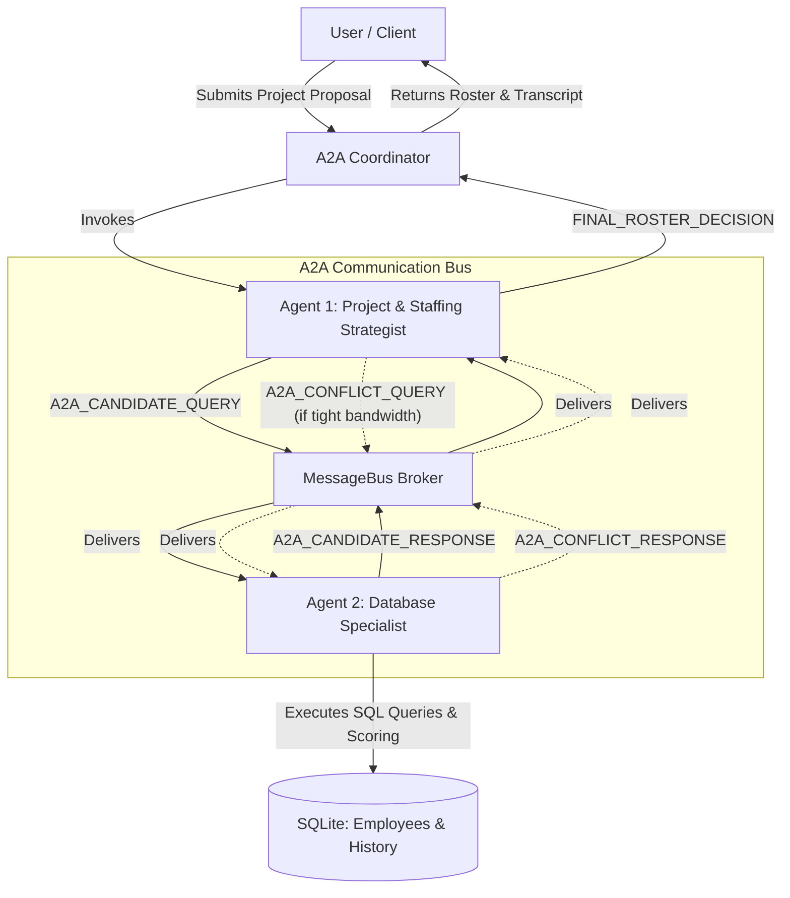
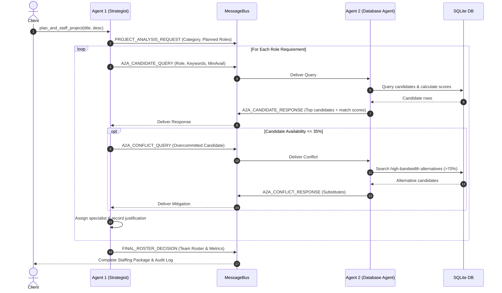

# Architecture Specification: Agent-to-Agent (A2A) Office Staffing System

## 1. System Philosophy & Objectives
The system addresses the organizational problem of staffing complex cross-functional corporate initiatives. Instead of monolithic heuristics or rigid manual filtering, it implements a decoupled **Agent-to-Agent (A2A)** architecture:
- **Separation of Concerns**: Strategic project analysis and team optimization (Agent 1) is decoupled from data storage, skill filtering, and personnel retrieval (Agent 2).
- **Explicit Protocol**: Agents interact using typed JSON messages over a shared message broker rather than invoking private methods directly.
- **Auditability**: Every inquiry, reasoning monologue, conflict negotiation, and candidate evaluation is captured chronologically in an immutable transcript.

---

## 2. Component Diagram



---

## 3. Agent Specifications

### Agent 1: Project & Staffing Strategist (`ProjectStaffingAgent`)
* **Role ID**: `agent_project_planner`
* **Responsibilities**:
  1. **Domain Classification**: Analyzes project titles and descriptions using textual signal analysis to classify them as `tech`, `non_tech`, or `hybrid`.
  2. **Competency Mapping**: Breaks project scope down into a set of discrete roles (`RoleRequirement`), specifying required skill keywords, minimum experience threshold, and target bandwidth.
  3. **Candidate Negotiation**: Emits `A2A_CANDIDATE_QUERY` messages to Agent 2.
  4. **Bandwidth Conflict Resolution**: Detects if high-priority candidates have availability $\le 35\%$. If so, issues an `A2A_CONFLICT_QUERY` to Agent 2 to discover high-bandwidth alternatives.
  5. **Synthesis**: Emits the `FINAL_ROSTER_DECISION` with allocations and justifications.

### Agent 2: Database & Resource Specialist (`DatabaseAgent`)
* **Role ID**: `agent_employee_db`
* **Responsibilities**:
  1. **Database Interrogation**: Queries the SQLite `employees` table by category (`tech`, `non_tech`, `hybrid`).
  2. **Candidate Relevance Scoring**: Computes composite match scores ($0 - 100$ scale) based on keyword matching ($50\%$), availability ($30\%$), and performance/experience ($20\%$).
  3. **Fallback Handling**: Gracefully relaxes strict availability constraints if no active candidates meet the initial criteria.
  4. **Alternative Discovery**: When queried for conflicts, searches specifically for cross-trained personnel with $\ge 70\%$ bandwidth.

---

## 4. A2A Sequence Flow



---

## 5. Protocol Message Envelope Schema

Every message traversing the A2A bus conforms to the `A2AMessage` Pydantic model:

```json
{
  "id": "e9a1b4c2",
  "timestamp": "2026-11-04 15:30:34",
  "sender": "agent_project_planner",
  "recipient": "agent_employee_db",
  "message_type": "A2A_CANDIDATE_QUERY",
  "summary": "Requesting candidates for 'AI / ML Solutions Engineer'",
  "payload": {
    "role_requirement": {
      "role_name": "AI / ML Solutions Engineer",
      "category": "tech",
      "keywords": ["Python", "PyTorch", "LLMs", "RAG"],
      "min_experience_years": 4,
      "required_bandwidth_percent": 50,
      "is_leadership": false
    }
  },
  "reasoning": "Need candidate with strong LLM and vector database pipeline experience."
}
```

### Supported Message Types:
| Message Type | Sender | Recipient | Description |
|---|---|---|---|
| `PROJECT_ANALYSIS_REQUEST` | Agent 1 | Client | Project domain classification and planned role list |
| `A2A_CANDIDATE_QUERY` | Agent 1 | Agent 2 | Formal request for candidates matching role criteria |
| `A2A_CANDIDATE_RESPONSE` | Agent 2 | Agent 1 | Ranked candidate pool with calculated match scores |
| `A2A_CONFLICT_QUERY` | Agent 1 | Agent 2 | Escalation of resource or availability bottlenecks |
| `A2A_CONFLICT_RESPONSE` | Agent 2 | Agent 1 | High-bandwidth substitutes or paired staffing recommendations |
| `FINAL_ROSTER_DECISION` | Agent 1 | Client | Final team roster, aggregated metrics, and justifications |

---

## 6. Relevance Scoring Algorithm

Candidate ranking in Agent 2 utilizes a composite scoring formula:

$$\text{Score} = S_{\text{keywords}} + S_{\text{availability}} + S_{\text{performance}} + S_{\text{experience}}$$

* **Keyword Match ($S_{\text{keywords}}$, max 50 pts)**:
  $$\min\left(50, \frac{\text{matched keywords}}{\text{total keywords requested}} \times 50\right)$$
* **Availability ($S_{\text{availability}}$, max 30 pts)**:
  $$\frac{\text{availability\_percent}}{100} \times 30$$
* **Performance Rating ($S_{\text{performance}}$, max 10 pts)**:
  $$\frac{\text{rating}}{5.0} \times 10$$
* **Experience ($S_{\text{experience}}$, max 10 pts)**:
  $$\min\left(10, \frac{\text{years\_experience}}{10} \times 10\right)$$

This formula balances **technical fit** with **operational reality** so that an employee with high skill but 0% availability is not blindly assigned over a capable peer with 100% capacity.

